  

  <a href="mailto:hamzasherjeel04@gmail.com">Email</a>&nbsp;&nbsp;·&nbsp;&nbsp;<a href="https://www.linkedin.com/in/hamza-sherjeel">LinkedIn</a>&nbsp;&nbsp;·&nbsp;&nbsp;<a href="https://github.com/ahdilaw/llm-personas">Latest paper</a>

  

  

  
  

  
  

  

  

  

